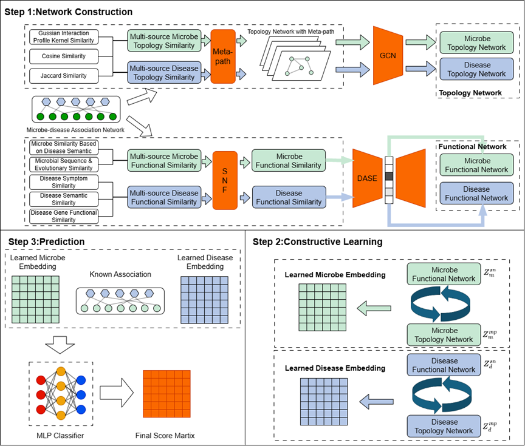

# GECLMAD
**GECLMAD: a graph-enhanced contrastive learning framework for microbe–disease association prediction**

## workflow

### Dataset ###
* HMDAD: HMDAD has 450 non-redundant associations among 292 microbes and 39 diseases.
* Disbiome：Disbiome has8,645 associations involving 351 microbes and 1,582 diseases

### Data description ###
* adj: microbe and disease interactions
* diseasefeatures: pre-processed feature matrix for diseases.
* microbefeatures: pre-processed feature matrix for microbes.
* diseasesimilarity: integrated disease similarity matrix.
* microbesimilarity: integrated microbe similarity matrix.

### Run Step ###
Run train.py to train the model and obtain the predicted scores for microbe-drug associations.

### Citation ###
Please kindly cite the paper if you use refers to the paper, code or datasets.